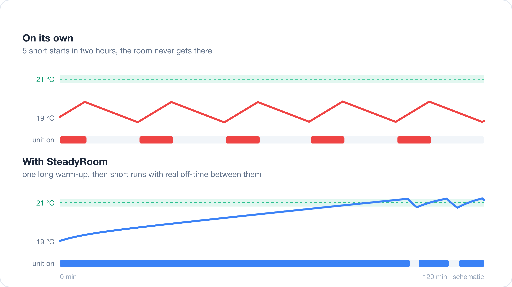
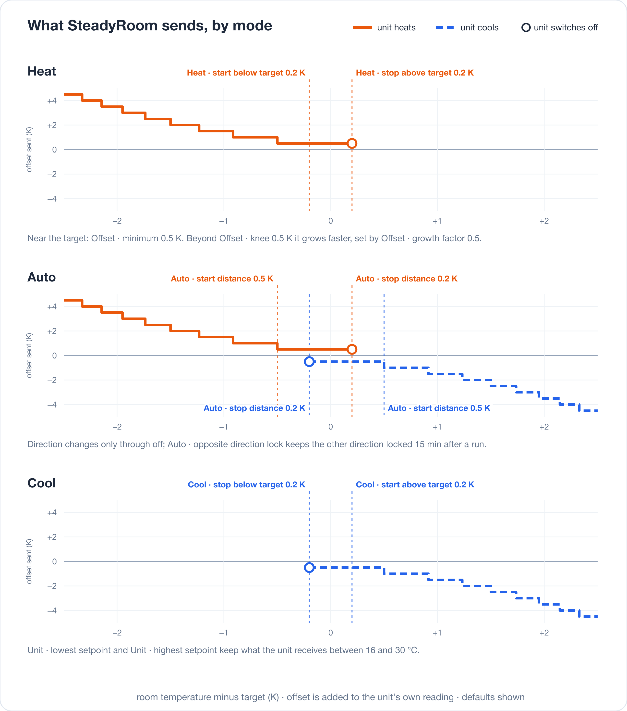

# SteadyRoom

**Your heat pump switches on, off, on, off, and the sofa never gets warm? SteadyRoom fixes that.** It cuts the short cycling of air conditioners whose built-in sensor sits in the wrong place down to fewer, real runs, and turns them into a calm, precise room thermostat.

- 🎯 **Measures where you live**: decides from a sensor in the middle of the room, not from the unit's housing.
- 🌊 **Fewer, real runs**: the unit runs until the room is in the band and is then really off, instead of flicking between idle and running every few minutes.
- 🧩 **One entity, no automation spaghetti**: works with the standard Thermostat and Tile cards, all settings on the device page.
- 🛡️ **Safe to try**: every new device starts in *Observe only* and touches nothing until you let it.

## The problem

Most split units measure the temperature at their own housing, high up on the wall, right in the warm air they blow out. When heating, they believe the room has reached the target long before its centre has, throttle down, switch off, start again a few minutes later. The room swings, the compressor cycles, and nobody is comfortable.

## The fix

SteadyRoom puts a virtual thermostat on top of your unit. It decides heat, cool or off from a sensor in the middle of the room, and it gives the unit a setpoint relative to the unit's *own* reading. The unit therefore sees a clear demand and keeps running until the room itself is where you want it. Then it really switches off and stays off until the room needs it again.

*Schematic illustration of the effect, not a measurement.*

## What you get

One climate entity per room. Put it on the standard **Thermostat card** or a **Tile card** and you have everything in one place: room temperature, target, mode (Off, Heat, Cool, Auto) and what the unit is doing. Fan speed and vane position pass through to your unit. All tuning values live as settings on the device page.

| Thermostat card | Device page |
|---|---|
|  |  |

The difference in one glance: the room centre reads 20.4 °C while the wall unit believes it is already at 25 °C.

It replaces what usually takes an automation and a handful of helpers: a target helper, a mode selector, an on/off switch for the schedule and four time helpers.

## Get started

Requires Home Assistant 2026.10 or newer.

1. In Home Assistant open the **Marketplace**, choose **Add from link** and enter `https://github.com/b80k/steadyroom`.
2. Install **SteadyRoom** and restart Home Assistant.
3. **Settings → Devices & services → Add integration → SteadyRoom**.
4. Fill in the setup fields below: the air conditioner and the room temperature sensor are required, the rest is optional.
5. A new device starts with **Observe only** switched on and no mode chosen: it touches nothing on your unit yet. Pick a mode on the thermostat card, compare `would_hvac_mode` and `would_setpoint` with what your unit does, then turn **Observe only** off on the device page to let SteadyRoom take over.

### Setup fields

You fill these in when adding SteadyRoom. To change them later, open the integration and choose **Configure**.

| Field | What to enter | What it does |
|---|---|---|
| **Name** | A name for the room, e.g. `Living room`. | Names the new thermostat device and its entities. |
| **Air conditioner** (required) | The climate entity of your split unit or heat pump, as provided by its own integration. It must report its current temperature. | SteadyRoom sends mode and setpoint to this entity and reads the unit's own temperature from it. |
| **Room temperature sensor** (required) | A temperature sensor in the middle of the room, at sitting height, away from the unit's airflow, sun and radiators. | Every decision is made from this value. |
| **Fallback temperature sensor** | Optional: a second temperature sensor in the same room. | Used while the room sensor is unavailable. Without either sensor, SteadyRoom does not start the unit. |
| **Door and window contacts** | Optional: the binary sensors of the doors and windows of this room, including open doorways to rooms the unit also serves. | While one stays open longer than **Door · open delay**, the unit switches off. |
| **Contacts report closed as on** | Turn on only if your contacts are `on` when closed, as with many Loxone or KNX inputs. Standard door sensors are `on` when open: leave it off. | Flips how the contacts are read. |
| **Schedule** | Optional: a Home Assistant *Schedule* helper with the times the room should be conditioned. | Outside its blocks the unit stays off. Leave empty to control around the clock. |

## How it decides

| Mode | Starts | Stops |
|---|---|---|
| Heat | room below target − 0.2 K | room at target + 0.2 K |
| Cool | room above target + 0.2 K | room at target − 0.2 K |
| Auto | heating below target − 0.5 K, cooling above target + 0.5 K | at target ± 0.2 K |

Between start and stop the unit keeps doing what it did (hysteresis). In **Auto**, a running unit never switches straight to the opposite direction: it switches off first, and the opposite direction stays locked for 15 minutes after a run ended. That prevents heat–cool ping-pong around the target.

The chart shows, for each mode, where the unit starts and stops and what offset it receives on the way. Every threshold carries the name of the setting that moves it.

## The setpoint sent to the unit

The setpoint is the unit's own measured temperature plus an offset (minus, when cooling). The offset depends on how far the room is from the target:

- up to 0.5 K away: 0.5 K,
- beyond that it grows quadratically: g = d + 0.5 · (d − 0.5)², rounded up to the unit's step (usually 0.5 K).

| Room behind target by | Offset |
|---|---|
| ≤ 0.50 K | 0.5 K |
| ≤ 0.91 K | 1.0 K |
| ≤ 1.23 K | 1.5 K |
| ≤ 1.50 K | 2.0 K |
| ≤ 1.73 K | 2.5 K |
| 2.50 K | 4.5 K |

The offset itself has no cap; only the final setpoint is limited (16–30 °C by default). A new setpoint is only sent when it differs by at least half a step, so the unit is not flooded with commands.

## Doors, windows and schedule

- **Contacts**: if any contact stays open for 60 s, the unit switches off. While a contact is open, a stopped unit does not start. Once all contacts have been closed for 15 s, the unit resumes the direction it had before. If your contacts report *closed* as `on`, tick the inversion option. A contact that is `unavailable` or `unknown` counts as closed, so a sensor with a flat battery does not keep your unit off.
- **Schedule**: pick a Home Assistant *Schedule* helper. Outside its blocks the unit stays off. Without a schedule SteadyRoom is always active. If the schedule becomes `unavailable`, `unknown` or disappears, SteadyRoom keeps its last answer (inside, if it never had one) instead of switching the unit off.

## Robust by design

- If the room sensor is unavailable, SteadyRoom uses the fallback sensor; without either it will not start heating or cooling and says so. Switching off (mode Off, open door, end of schedule) always goes out, sensor or not. With **Sensor · maximum age** set, a sensor that has not reported for that long counts as unavailable too.
- When the unit comes back after a connection loss, SteadyRoom sends nothing for 30 s, then re-sends mode and setpoint. Cloud-connected units otherwise keep running on a command they missed. A return from unavailable never counts as the end of a run, so it does not start the Auto lock.
- A command the unit rejects is tried again after 30 s. `sent_setpoint` only shows setpoints the unit accepted.
- Nothing is sent before Home Assistant has finished starting.
- In mode **Off** SteadyRoom keeps the unit off. That includes *dry* or *fan only* started from the remote or another app: SteadyRoom switches it off again.
- Mode, target, last direction and the lock survive restarts.
- It only ever sends commands to the unit you selected. If you rename the unit, a sensor, a contact or the schedule, SteadyRoom follows the new entity id. If the unit's entity is removed, SteadyRoom stops sending and never commands another entity that later takes over the old id; select the unit again under **Configure**.

## Settings

All values are number entities on the SteadyRoom device page and take effect immediately. Each name starts with its group, so the page lists them group by group. The defaults work for most split units; change one value at a time and watch a day before the next.

⚙️ marks fine tuning. These start disabled, so the device page folds them into **+5 disabled entities** and keeps the list short. While disabled they keep their default. To change one, open it there and enable it; Home Assistant reloads SteadyRoom after about 30 seconds.

### Heat and Cool

| Setting | Enter | Default | What it does |
|---|---|---|---|
| **Heat · start below target** | 0–5 K | 0.2 K | Heating starts once the room is this far below the target. |
| **Heat · stop above target** | 0–5 K | 0.2 K | Heating stops once the room is this far above the target. |
| **Cool · start above target** | 0–5 K | 0.2 K | Cooling starts once the room is this far above the target. |
| **Cool · stop below target** | 0–5 K | 0.2 K | Cooling stops once the room is this far below the target. |

Start and stop together form the band around the target in which the unit keeps doing what it does. A wider band means fewer starts and a room that swings a little more; a narrower band holds the target tighter with more starts.

### Auto

| Setting | Enter | Default | What it does |
|---|---|---|---|
| **Auto · start distance** | 0–5 K | 0.5 K | A stopped unit starts heating this far below the target, or cooling this far above it. |
| **Auto · stop distance** | 0–5 K | 0.2 K | A running unit stops this far past the target: heating above it, cooling below it. |
| **Auto · opposite direction lock** | 0–240 min | 15 min | After a run ends, the opposite direction may not start for this long. 0 switches the lock off. |

Keep the start distance larger than the stop distance. Otherwise the point where heating stops already lies beyond the point where cooling starts, and only the lock keeps the unit from switching back and forth.

### Doors

| Setting | Enter | Default | What it does |
|---|---|---|---|
| **Door · open delay** | 0–3600 s | 60 s | How long a door or window must stay open before the unit switches off. A quick step outside does not stop it; 0 switches off at once. |
| **Door · close delay** | 0–3600 s | 15 s | How long all doors and windows must be closed before the unit resumes the direction it had. |

These only matter if you selected contacts during setup.

### Offset

| Setting | Enter | Default | What it does |
|---|---|---|---|
| **Offset · minimum** | 0–10 K | 0.5 K | The smallest offset added to the unit's own reading while it runs. If the unit still throttles down or switches itself off just before the room reaches the target, raise it; if the room overshoots, lower it. |
| **Offset · knee** ⚙️ | 0–10 K | 0.5 K | Up to this distance from the target, the offset equals the distance, rounded up to the unit's step and never below the minimum. Beyond it, the offset grows faster than the distance. |
| **Offset · growth factor** ⚙️ | 0–10 | 0.5 | How much faster it grows beyond the knee: offset = d + factor · (d − knee)². Raise it to catch up faster from far behind, for example after a cold night; 0 makes the offset follow the distance. |

### Unit and sensor

| Setting | Enter | Default | What it does |
|---|---|---|---|
| **Unit · lowest setpoint** ⚙️ | 7–35 °C | 16 °C | SteadyRoom never sends a lower setpoint. Set it to the lowest value your unit accepts. |
| **Unit · highest setpoint** ⚙️ | 7–35 °C | 30 °C | SteadyRoom never sends a higher setpoint. Set it to the highest value your unit accepts. The lowest may not be above the highest; SteadyRoom rejects such a value. |
| **Sensor · maximum age** ⚙️ | 0–1440 min | 0 min | A room sensor that has not reported for this long counts as unavailable. Use it only for sensors that report at a fixed interval, and choose well above that interval, e.g. 30 min for a sensor reporting every 5 min. Many battery sensors only report when the value changes: leave 0 (no limit) there. |

To change the unit, sensors, contacts or schedule later, use **Configure** on the integration.

### Observe only

Every new device starts with the **Observe only** switch on; turn it off to let SteadyRoom take over. While it is on, SteadyRoom decides as usual but sends nothing to the unit; the attributes `would_hvac_mode` and `would_setpoint` show what it would do, so you can compare it with an existing automation for a few days. The Auto lock follows what the real unit does. Turning the switch off makes SteadyRoom take over and send mode and setpoint at once. The switch position is stored with the device's configuration and survives a crash.

Fan speed and vane position still pass through to the unit while observing: they are your own commands, not SteadyRoom's decisions.

Until you choose a mode for the first time, SteadyRoom sends nothing at all, even with **Observe only** off (`reason: not_configured`).

## Diagnostics

The climate entity carries attributes that explain every decision: `reason` (`not_configured`, `off_mode`, `in_band`, `heating`, `cooling`, `door_open`, `outside_schedule`, `locked`, `sensor_missing`, `unit_unavailable`), `distance`, `offset`, `sent_setpoint`, `last_direction`, `run_ended_at`, `locked_direction`, `lock_until`, `would_hvac_mode`, `would_setpoint`, `observe_only`.

## Not included

SteadyRoom does not compute the room temperature from several sensors, does not drive radiator valves or relays, and has no presence or presets. Use any temperature sensor you trust as input.
