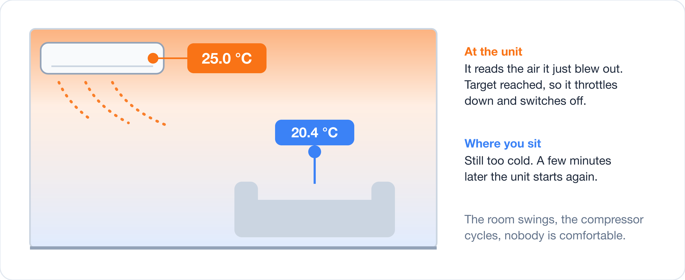
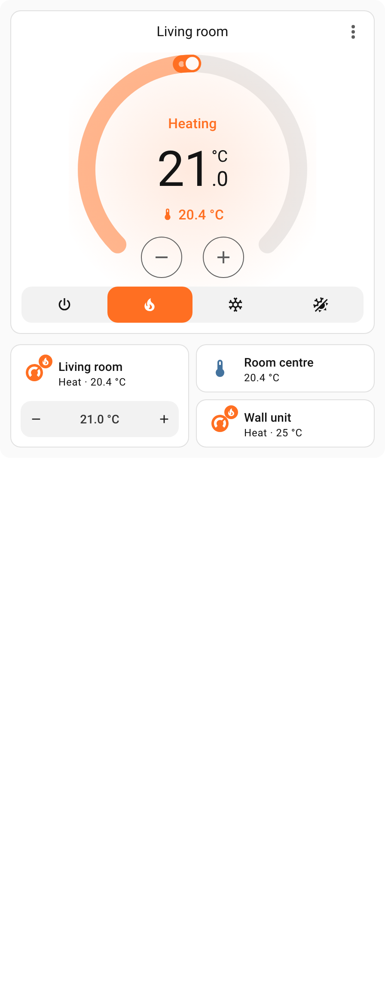
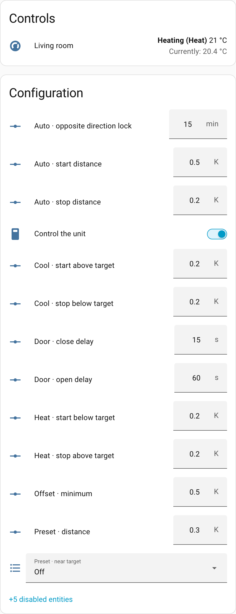
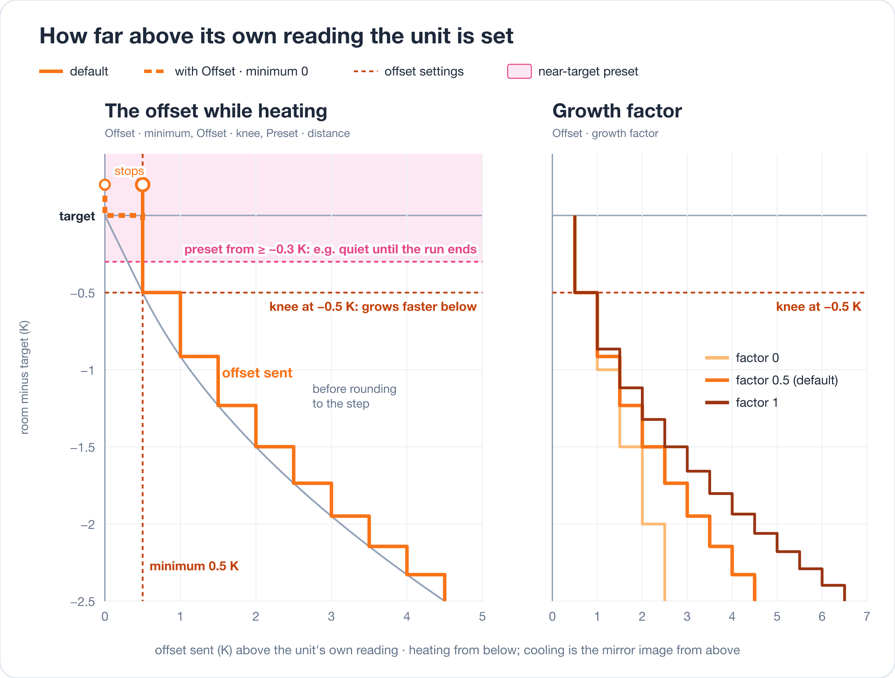

# SteadyRoom

**Your heat pump switches on, off, on, off, and the sofa never gets warm? SteadyRoom fixes that.** It cuts the short cycling of air conditioners whose built-in sensor sits in the wrong place down to fewer, real runs, and turns them into a calm, precise room thermostat.

- 🎯 **Measures where you live**: decides from a sensor in the middle of the room, not from the unit's housing.
- 🌊 **Fewer, real runs**: the unit runs until the room is just past the target and is then really off, instead of flicking between idle and running every few minutes.
- 🧩 **One entity, no automation spaghetti**: works with the standard Thermostat and Tile cards, all settings on the device page.
- 🛡️ **Safe to try**: every new device starts as a test run and touches nothing until you switch on *Control the unit*.

## The problem

Most split units measure the temperature at their own air intake, high up on the wall, where the warm air they blow out collects. When heating, they believe the room has reached the target long before its centre has, throttle down, switch off, start again a few minutes later. The room swings, the compressor cycles, and nobody is comfortable.

## The fix

SteadyRoom puts a virtual thermostat on top of your unit. It decides heat, cool or off from a sensor in the middle of the room, and it gives the unit a setpoint relative to the unit's *own* reading. The unit therefore sees a clear demand and keeps running until the room itself is where you want it. Then it really switches off and stays off until the room needs it again.

Your unit's display, its remote and the vendor's app show the setpoint SteadyRoom sends, not your target: 26 °C while you want 21 °C, for example. That is intended. Your target is the one on the SteadyRoom thermostat.

*Schematic illustration of the effect, not a measurement.*

## What you get

One climate entity per room. Put it on the standard **Thermostat card** or a **Tile card** and you have everything in one place: room temperature, target, mode (Off, Heat, Cool, Auto) and what the unit is doing. Home Assistant labels the Auto mode *Heat/Cool*. Fan speed, vane position (up and down, left and right) and your unit's own presets, such as *quiet* or *powerful*, pass through to your unit, and SteadyRoom can switch to one of them near the target ([Preset near the target](#preset-near-the-target)). SteadyRoom offers exactly what your unit reports, nothing more. Extras your integration adds as separate entities, such as an air purifier switch, stay on the unit's own device. All tuning values live as settings on the device page.

| Thermostat and Tile cards | Device page |
|---|---|
|  |  |

The tiles show the difference in one glance: the room centre reads 20.4 °C while the wall unit believes it is already at 25 °C.

It replaces what usually takes an automation and a handful of helpers: a target helper, a mode selector, an on/off switch for the schedule and four time helpers.

## Get started

### What you need

- Home Assistant 2026.10 or newer, set to Celsius. SteadyRoom's limits and defaults are Celsius values; Fahrenheit installations are not supported yet.
- Your unit as a climate entity that reports its own current temperature and accepts heat, cool, off and a target temperature.
- A temperature sensor in the room: a sensor entity with the device class *temperature*. The setup form only offers those.
- Optional: door and window contacts (binary sensors) and a *Schedule* helper.

SteadyRoom is in daily use with two Panasonic units connected through the Panasonic Comfort Cloud integration. Other brands should work if their climate entity meets the points above. The interface is available in English and German.

### Install

1. In Home Assistant open **Settings → Marketplace**, choose **Add from link** and enter `https://github.com/b80k/steadyroom`. Adding a link needs a GitHub connection: Home Assistant shows a code that you confirm with your GitHub account.
2. Install **SteadyRoom** and restart Home Assistant. Before the first installation the Marketplace asks you to accept its notice about community projects.
3. **Settings → Devices & services → Add integration → SteadyRoom**.
4. Fill in the setup fields below: the air conditioner and the room temperature sensor are required, the rest is optional.
5. A new device starts as a test run: **Control the unit** is off and no mode is chosen, so it touches nothing on your unit yet. Open the new thermostat, for example from its device page under *Controls*, and pick a mode. Then choose **⋮ → Details** in the same dialog: under *Attributes*, **Mode SteadyRoom wants** and **Setpoint SteadyRoom wants** show what SteadyRoom would send. Compare that with what your unit does, then switch **Control the unit** on (device page, *Configuration*) to let SteadyRoom take over.

The Marketplace is built into Home Assistant from 2026.11. On 2026.10, add the same link in HACS under **Custom repositories** with the type *Integration*.

Without Marketplace or HACS: download the source code of the [latest release](https://github.com/b80k/steadyroom/releases/latest), copy the folder `custom_components/steadyroom` into the `custom_components` folder of your Home Assistant configuration and restart.

To update, install the new version the Marketplace offers, or copy the folder again, and restart. To remove SteadyRoom, delete its entries under **Settings → Devices & services**, then uninstall it. SteadyRoom sends nothing when it is removed: the unit keeps the mode and setpoint it had last.

### Setup fields

You fill these in when adding SteadyRoom. To change them later, open the integration and choose **Configure**.

| Field | What to enter | What it does |
|---|---|---|
| **Name** | A name for the room, e.g. `Living room`. | Names the new thermostat device and its entities. |
| **Air conditioner** (required) | The climate entity of your split unit or heat pump, as provided by its own integration. It must report its current temperature. | SteadyRoom sends mode and setpoint to this entity and reads the unit's own temperature from it. |
| **Room temperature sensor** (required) | A temperature sensor in the middle of the room, at sitting height, away from the unit's airflow, sun and radiators. | Every decision is made from this value. |
| **Fallback temperature sensor** | Optional: a second temperature sensor in the same room. | Used while the room sensor is unavailable. Without either sensor, SteadyRoom does not start the unit. |
| **Door and window contacts** | Optional: the binary sensors of the doors and windows of this room. If the unit also serves an adjoining room through an open doorway, add that room's doors and windows too. | While one stays open longer than **Door · open delay**, the unit switches off. |
| **Contacts report closed as on** | Turn on only if your contacts are `on` when closed, as with many Loxone or KNX inputs. Standard door sensors are `on` when open: leave it off. | Flips how the contacts are read. |
| **Schedule** | Optional: a Home Assistant *Schedule* helper with the times the room should be conditioned. | Outside its blocks the unit stays off. Leave empty to control around the clock. |

## How it decides

| Mode | Starts | Stops |
|---|---|---|
| Cool | room ≥ target + 0.2 K | room ≤ target − 0.2 K |
| Auto | heating at room ≤ target − 0.5 K, cooling at room ≥ target + 0.5 K | heating at room ≥ target + 0.2 K, cooling at room ≤ target − 0.2 K |
| Heat | room ≤ target − 0.2 K | room ≥ target + 0.2 K |

Each value is the switching point itself: with a target of 20.0 °C, heating starts at 19.8 °C and stops at 20.2 °C, so the band is the same on both sides. Between start and stop the unit keeps doing what it did (hysteresis). In **Auto**, the mode Home Assistant labels *Heat/Cool*, a running unit never switches straight to the opposite direction: it switches off first, and the opposite direction stays locked for 15 minutes after a run ended. That prevents heat–cool ping-pong around the target.

The chart shows Cool, Auto and Heat side by side. The room temperature runs up the left axis, so cooling comes down to the target from above and heating comes up from below. Each dashed line is a switching point, coloured by the direction it belongs to and labelled with its condition; the curve shows the offset the unit receives on the way.

## The setpoint sent to the unit

The setpoint is the unit's own measured temperature plus an offset (minus, when cooling). The offset depends on how far the room is from the target, d, and on three settings:

- up to **Offset · knee** (0.5 K), the offset is d itself,
- beyond the knee it grows quadratically: d + **Offset · growth factor** · (d − knee)², with 0.5 · (d − 0.5)² by default,
- the result is rounded up to the unit's step (usually 0.5 K) and never falls below **Offset · minimum** (0.5 K).

The left panel shows the default curve while heating; cooling is its mirror image. Near the target the offset sits on the minimum, and with **Offset · minimum** 0 it drops to 0 once the room reaches the target, so the unit is only asked to hold its own reading until the run stops. The pink band is where **Preset · near target** applies. The right panel shows what **Offset · growth factor** does far from the target.

With the defaults this gives:

| Room behind target by | Offset |
|---|---|
| ≤ 0.50 K | 0.5 K |
| ≤ 0.91 K | 1.0 K |
| ≤ 1.23 K | 1.5 K |
| ≤ 1.50 K | 2.0 K |
| ≤ 1.73 K | 2.5 K |
| 2.50 K | 4.5 K |

The offset itself has no cap; only the final setpoint is limited (16–30 °C by default). A new setpoint is only sent when it differs by at least half a step, so the unit is not flooded with commands.

## Doors, windows and schedule

- **Contacts**: if any contact stays open for 60 s, the unit switches off. While a contact is open, a stopped unit does not start. Once all contacts have been closed for 15 s, the unit resumes the direction it had before. If your contacts report *closed* as `on`, tick the inversion option. A contact that is `unavailable` or `unknown` counts as closed, so a sensor with a flat battery does not keep your unit off.
- **Schedule**: pick a Home Assistant *Schedule* helper. Outside its blocks the unit stays off. Without a schedule SteadyRoom is always active. If the schedule becomes `unavailable`, `unknown` or disappears, SteadyRoom keeps its last answer (inside, if it never had one) instead of switching the unit off.

## Remote control and vendor app

While **Control the unit** is on, mode and setpoint belong to SteadyRoom. What the remote, the vendor's app or another automation changes there, SteadyRoom puts back as soon as the unit reports it: a changed setpoint is replaced, and a unit put into *dry* or *fan only* is switched back to off, heating or cooling, whichever SteadyRoom wants at that moment. Only switching on or off by hand inside the band stays until the next switching point: a unit started in a direction the chosen mode allows runs until its stop point, a unit stopped rests until its start point.

To use *dry* or *fan only*, or to run the unit by hand, switch **Control the unit** off. Fan speed and vane position stay as you set them; so does the preset, unless you chose one under [Preset near the target](#preset-near-the-target).

## Robust by design

- If the room sensor is unavailable, SteadyRoom uses the fallback sensor; without either it will not start heating or cooling and says so. A unit that is already running then keeps its last setpoint and regulates on its own reading until a sensor is back. Switching off (mode Off, open door, end of schedule) always goes out, sensor or not. With **Sensor · maximum age** set, a sensor that has not reported for that long counts as unavailable too.
- When the unit comes back after a connection loss, SteadyRoom sends nothing for 30 s, then re-sends mode and setpoint. Cloud-connected units otherwise keep running on a command they missed. A return from unavailable never counts as the end of a run, so it does not start the Auto lock.
- A command the unit rejects is tried again after 30 s. `sent_setpoint` only shows setpoints the unit accepted.
- Nothing is sent before Home Assistant has finished starting.
- If Home Assistant itself stops, the unit likewise keeps the last mode and setpoint it received and regulates on its own reading, like a unit without SteadyRoom. **Unit · lowest setpoint** and **Unit · highest setpoint** limit that setpoint.
- Mode, target, last direction and the lock survive restarts.
- It only ever sends commands to the unit you selected. If you rename the unit, a sensor, a contact or the schedule, SteadyRoom follows the new entity id. If the unit's entity is removed, SteadyRoom stops sending and never commands another entity that later takes over the old id; select the unit again under **Configure**.

## Settings

All tuning values are number entities on the SteadyRoom device page; **Preset · near target** is a selection. Changes take effect immediately. Each name starts with its group, so the page lists them group by group. The **Control the unit** switch sits among them; it is explained under [Test run](#test-run-control-the-unit). The defaults come from two Panasonic units and are a starting point; change one value at a time and watch a day before the next.

⚙️ marks fine tuning. These start disabled, so the device page folds them into **+5 disabled entities** and keeps the list short. While disabled they keep their default. To change one, open it there and enable it; Home Assistant reloads SteadyRoom after about 30 seconds.

### Heat and Cool

| Setting | Enter | Default | What it does |
|---|---|---|---|
| **Heat · start below target** | 0–5 K | 0.2 K | Heating starts once the room is this far below the target. |
| **Heat · stop above target** | 0–5 K | 0.2 K | Heating stops once the room is this far above the target. |
| **Cool · start above target** | 0–5 K | 0.2 K | Cooling starts once the room is this far above the target. |
| **Cool · stop below target** | 0–5 K | 0.2 K | Cooling stops once the room is this far below the target. |

Start and stop together form the band around the target in which the unit keeps doing what it does. A wider band means fewer starts and a room that swings a little more; a narrower band holds the target tighter with more starts.

### Auto

| Setting | Enter | Default | What it does |
|---|---|---|---|
| **Auto · start distance** | 0–5 K | 0.5 K | A stopped unit starts heating this far below the target, or cooling this far above it. |
| **Auto · stop distance** | 0–5 K | 0.2 K | A running unit stops this far past the target: heating above it, cooling below it. |
| **Auto · opposite direction lock** | 0–240 min | 15 min | After a run ends, the opposite direction may not start for this long. 0 switches the lock off. |

Keep the start distance larger than the stop distance. Otherwise the point where heating stops already lies beyond the point where cooling starts, and only the lock keeps the unit from switching back and forth.

### Doors

| Setting | Enter | Default | What it does |
|---|---|---|---|
| **Door · open delay** | 0–3600 s | 60 s | How long a door or window must stay open before the unit switches off. A quick step outside does not stop it; 0 switches off at once. |
| **Door · close delay** | 0–3600 s | 15 s | How long all doors and windows must be closed before the unit resumes the direction it had. |

These only matter if you selected contacts during setup.

### Offset

| Setting | Enter | Default | What it does |
|---|---|---|---|
| **Offset · minimum** | 0–10 K | 0.5 K | See [the chart](#the-setpoint-sent-to-the-unit). The smallest offset added to the unit's own reading while it runs. If the unit still throttles down or switches itself off just before the room reaches the target, raise it; if the room overshoots, lower it. |
| **Offset · knee** ⚙️ | 0–10 K | 0.5 K | Up to this distance from the target, the offset equals the distance, rounded up to the unit's step and never below the minimum. Beyond it, the offset grows faster than the distance. |
| **Offset · growth factor** ⚙️ | 0–10 | 0.5 | How much faster it grows beyond the knee: offset = d + factor · (d − knee)². Raise it to catch up faster from far behind, for example after a cold night; 0 makes the offset follow the distance. |

### Preset near the target

Only useful when your unit has presets, such as *quiet* on many Panasonic units; without presets the selection only offers *Off*. A quiet preset keeps a run gentle once the room is almost there, while a start from far away still gets full power.

| Setting | Enter | Default | What it does |
|---|---|---|---|
| **Preset · near target** | Off or one of your unit's presets | Off | Off leaves the preset to you. With a preset chosen, SteadyRoom sends it as soon as the room is within **Preset · distance** of the target, at the start of a run or during it, and keeps it until the run ends. A run that starts further away runs with *none*, if your unit offers it. |
| **Preset · distance** | 0–5 K | 0.3 K | How close to the target the room must be for the near-target preset. In Heat and Cool, a start after the room has just left the band is this close (0.2 K by default) and runs with the preset from the beginning. An Auto start is 0.5 K away: it begins without the preset and switches to it at this distance. |

The pink band in [the offset chart](#the-setpoint-sent-to-the-unit) shows where the preset applies. While a preset is chosen here, SteadyRoom sets the unit's preset at the start of every run. If you change the preset by hand during a run, SteadyRoom leaves your choice until that run ends.

### Unit and sensor

| Setting | Enter | Default | What it does |
|---|---|---|---|
| **Unit · lowest setpoint** ⚙️ | 7–35 °C | 16 °C | SteadyRoom never sends a lower setpoint. Set it to the lowest value your unit accepts. |
| **Unit · highest setpoint** ⚙️ | 7–35 °C | 30 °C | SteadyRoom never sends a higher setpoint. Set it to the highest value your unit accepts. The lowest may not be above the highest; SteadyRoom rejects such a value. |
| **Sensor · maximum age** ⚙️ | 0–1440 min | 0 min | A room sensor that has not reported for this long counts as unavailable. Use it only for sensors that report at a fixed interval, and choose well above that interval, e.g. 30 min for a sensor reporting every 5 min. Many battery sensors only report when the value changes: leave 0 (no limit) there. |

To change the unit, sensors, contacts or schedule later, use **Configure** on the integration.

### Test run: Control the unit

Every new device starts with the **Control the unit** switch off; switch it on to let SteadyRoom take over. While it is off, SteadyRoom decides as usual but sends nothing to the unit; the attributes **Mode SteadyRoom wants** and **Setpoint SteadyRoom wants** show what it would do (see [Diagnostics](#diagnostics)), so you can compare it with an existing automation for a few days. The Auto lock follows what the real unit does. Switching it on makes SteadyRoom take over and send mode and setpoint at once. The switch position is stored with the device's configuration and survives a crash.

Fan speed, vane position and presets still pass through to the unit during a test run: they are your own commands, not SteadyRoom's decisions.

Until you choose a mode for the first time, SteadyRoom sends nothing at all, even with **Control the unit** on (`reason: not_configured`).

Updating from 0.1.2 or earlier replaces the former *Observe only* switch with **Control the unit** and keeps the meaning: a room that was observing stays in a test run, a room under control stays under control.

## Diagnostics

The thermostat explains every decision in its attributes. Open it and choose **⋮ → Details** to see them; templates and automations use the names in the second column.

| Attribute | In templates | What it tells you |
|---|---|---|
| Reason | `reason` | Why the unit runs or rests, see the next table. |
| Distance to target | `distance` | Target minus room temperature in K: positive while the room is too cold. |
| Offset | `offset` | The offset in use, negative when cooling. |
| Setpoint sent to the unit | `sent_setpoint` | The setpoint the unit last accepted in the current run. |
| Mode SteadyRoom wants, Setpoint SteadyRoom wants | `would_hvac_mode`, `would_setpoint` | The decision itself. During a test run it only shows here. |
| Controls the unit | `controls_unit` | The position of the **Control the unit** switch. |
| Last direction, Last run ended | `last_direction`, `run_ended_at` | The unit's last heating or cooling run. |
| Locked direction, Locked until | `locked_direction`, `lock_until` | The Auto lock. |

| Reason | In templates | Meaning |
|---|---|---|
| Not configured: choose a mode | `not_configured` | No mode has been chosen yet. SteadyRoom sends nothing. |
| Mode is off | `off_mode` | Mode **Off**: the unit is kept off. |
| Room within band | `in_band` | No need to run: the room is within the band or already past the target. |
| Heating, Cooling | `heating`, `cooling` | SteadyRoom wants the unit to heat or cool. |
| Door or window open | `door_open` | A contact has been open longer than **Door · open delay**, or the contacts have not been closed long enough for a start. |
| Outside schedule | `outside_schedule` | Outside the schedule's blocks: the unit is kept off. |
| Opposite direction locked | `locked` | Auto would start the other direction, but the lock after the last run still holds. |
| Room temperature missing | `sensor_missing` | Neither the room sensor nor the fallback sensor delivers a value. |
| Air conditioner unavailable | `unit_unavailable` | The unit is unavailable or was removed, or it does not report its own temperature. |

## Not included

SteadyRoom does not compute the room temperature from several sensors, does not drive radiator valves or relays, and has no presence detection or presets of its own: the presets you see are your unit's. A unit preset that changes the unit's own setpoint, such as *eco* or *away* on some units, is overridden by the next setpoint SteadyRoom sends; choose such a preset for **Preset · near target** only if your unit keeps the setpoint SteadyRoom sends. Use any temperature sensor you trust as input.

## Feedback

Bugs, questions and reports from other brands are welcome in the [issues](https://github.com/b80k/steadyroom/issues).
